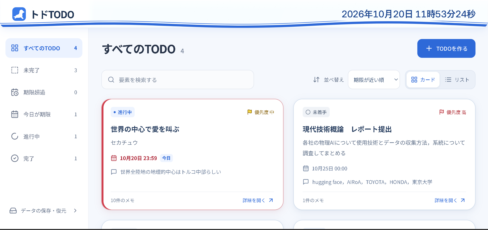
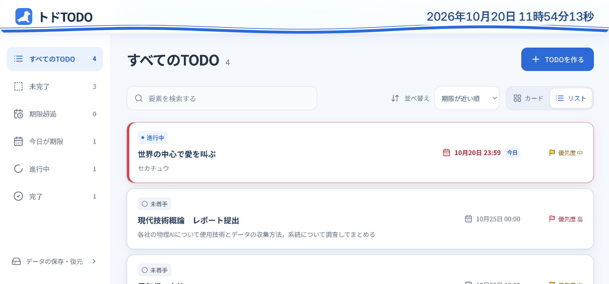
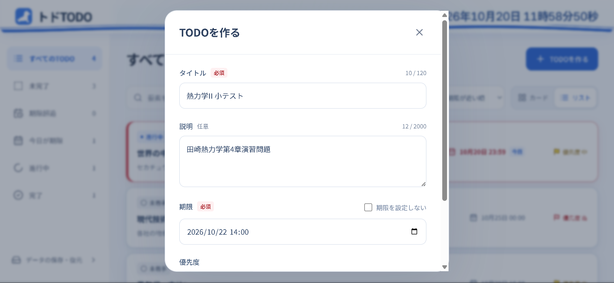
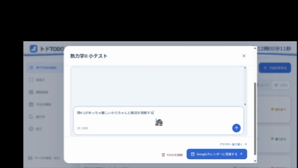
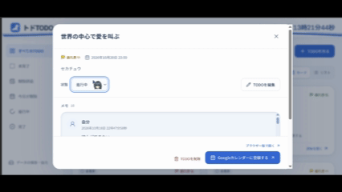
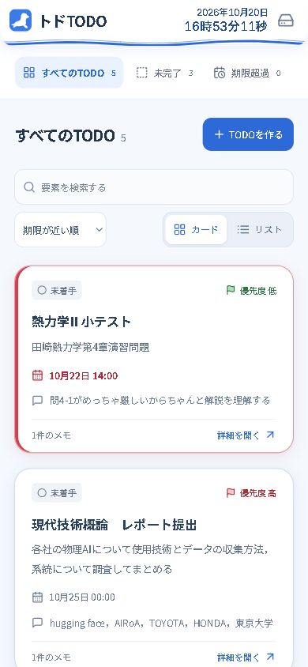
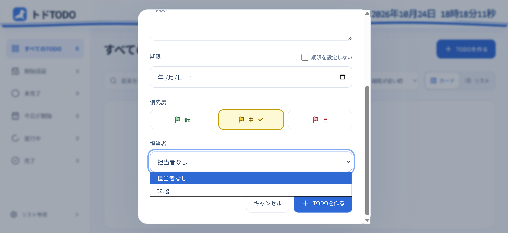

# トドTODO

青と白を基調とした、トドのアイコンのTODOアプリです。クラウド上に保存したリストを、招待URLを共有したメンバー同士で利用できます。

トドTODO（トドトゥードゥー）は、トドが獲物を食い荒らすように、気持ちよく、便利にTODOを消化できるウェブアプリケーションです。TODOごとにチャット風の進捗メモを残せることと、完了したカードがトドに変身して泳ぐ演出が特徴です。

https://github.com/user-attachments/assets/892dc094-22d2-45e4-be10-b221142fe6bd

## 開発

Node.js 22.12以降（推奨: Node.js 24）を使用してください。

```sh
npm ci
npm run dev
```

`npm run dev` はフロントエンド（Vite）だけを起動します。画面と `/api` をまとめてローカルで動かす場合は `vercel dev` を使用してください。APIだけを別プロセスで動かす場合は `npm run dev:api`（`.env.local` の `DATABASE_URL` を読む）を先に起動しておくと、Viteが `/api` を `http://127.0.0.1:3000` へプロキシします（`VITE_API_URL` で転送先を変更できます）。

初回は `.env.local`（Git管理外）に `DATABASE_URL` としてNeon devブランチの接続文字列を1行で記載してから起動します。新規DBは次の順で適用してください。

```sh
psql "$DATABASE_URL" -v ON_ERROR_STOP=1 -f db/schema.sql
```

`db/schema.sql` は空のDBへの初回適用用です。既存DBにはこのファイルを再適用せず、先にバックアップを取得して検証環境で確認したうえで、次の既存スキーマ向けマイグレーションだけを適用してください。

```sh
psql "$DATABASE_URL" -v ON_ERROR_STOP=1 -f db/migrations/001_subtasks.sql
```

このマイグレーションは `db/schema.sql` 適用済みの既存DBを前提とし、サブタスクとサブタスクメモ（`subtasks`・`subtask_memos`）、索引、revision更新用トリガーを再実行可能な形で追加します。接続文字列はコードやコミットに含めないでください。

注意: `npm install` や `npm ci` は実行した側のOS向け（WSLならLinux、PowerShellならWindows）のネイティブ依存（rollup・esbuild）だけを node_modules に残すため、WSLとPowerShellを行き来していたずらに実行すると、もう片方でビルドやテストが落ちます。途中で切り替えた場合は切り替えた側で `npm ci` を実行し直してください。

```sh
npm test
npm run build
npm run preview
npm run format
```

`npm test` はフロントエンドとAPIのテストを実行します。`TEST_DATABASE_URL` が未設定の場合、データベースを使うAPIテストはスキップされます。

## 開発の背景と目的

TODOを管理するだけでは、「どこまで進めたか」「次に何をするか」が分かりにくく、完了させたときにも、もう少し達成感がほしいと感じていました。

そこで、タスクごとに進捗や気づきを時系列で残せる機能と、完了を楽しめる演出を組み合わせました。機能の多さだけでなく、PCでもスマートフォンでも迷わず操作できることを目指しました。さらに、共有したいリストをそのままクラウドで共同利用できるようにしました。

## 機能

- 共有リストの作成と、招待URL（`#token=`）＋表示名での参加
- TODOの作成・編集・削除と、削除直後の取り消し
- 期限日時（任意）、優先度（選択欄は左から低・中・高）、状態（未着手・進行中・完了）、担当者
- 期限なしの新規作成、または期限ありから期限なしに変更する際の確認
- カードから開く詳細モーダルと、追記専用のチャット形式メモ
- 詳細モーダル内の変更履歴タイムライン（メモと作成・更新・削除などの履歴を時系列で表示）
- リストのタイトル変更、メンバーの名前変更・削除、リスト削除（2段階の確認）
- 期限順／優先度順、状態・今日の期限・期限超過での絞り込み、タイトル・説明・メモ検索
- 青い二本の波形ラインと、背景の透過・ぼかし・縁の反射によるLiquid Glass風の固定ヘッダー。トドのロゴ・TODOタイトル・毎秒更新の日時を表示（高さはPC 66px／スマートフォン58px）
- カードの輪郭と影を強め、これから期限を迎える未完了TODOのうち最も近い1件を赤い左縁と期限文字で強調（並び順には依存しない）
- 完了にしたTODOは「すべてのTODO」は完了済みも含め、末尾にまとめます。未完了・完了の各グループ内で選択中の期限順または優先度順を適用します。
- 優先度は高：赤、中：黄、低：緑（文字ラベルも併記）
- カード／簡潔表示を切り替え可能。簡潔表示はタイトル・説明・期限・優先度のみを表示し、行から詳細を開く。表示形式はこのブラウザに記憶
- チャット履歴と入力欄を同じ角丸のへこんだ領域に配置。メモは送信時に即時保存し、約0.4秒の「…」の後に本文の領域が滑らかに広がる。送信ボタンから入力欄にフォーカスを戻さず、モバイルのキーボードを再表示しない。連続送信も個別に演出。利用者の指定により、メモの演出は端末の「動きを減らす」設定より優先する
- Googleカレンダーの予定作成画面へのリンク（締切から15分間）
- クラウド版JSON（version 2）の書き出し
- レスポンシブ画面、キーボード操作、フォーカス表示、入力破棄・削除の確認

### 基本的な操作

1. **TODOを作る**から、タイトル・説明・期限・優先度を入力します。タイトルは必須です。期限が不要な場合は「期限を設定しない」を選びます。
2. 一覧のカードやリストの行を押して、詳細モーダルを開きます。ここで状態の変更、TODOの編集・削除、メモの送信ができます。
3. メモ欄には、「資料の整理まで完了」「次は図表を見直す」などを入力します。送信ボタンのほか、**Ctrl＋Enter／⌘＋Enter**でも送信できます。メモは追記式で、送信後の編集・個別削除はありません。
4. 管理画面では、リスト名の変更、メンバーの名前変更・削除、共有URL（招待URL）の確認、クラウド版JSONの書き出し、リストの削除ができます。
5. 状態を**完了**にして詳細を閉じると、未完了の一覧に切り替わり、完了演出が始まります。「演出をスキップする」またはEscキーで終了することもできます。

タイトルは120文字、説明とメモはそれぞれ2,000文字まで入力できます。入力欄には現在の文字数と上限を表示し、必須項目は赤い「必須」表示で区別しています。

「すべてのTODO」には完了済みも表示しますが、完了済みは末尾にまとめます。未完了・完了それぞれの中では、選択中の並び順を適用します。期限順では期限なしのTODOを最後に置き、これからの期限が最も近い未完了TODOには赤いアクセントを付けています。

### Googleカレンダーへの登録

期限を設定したTODOの詳細モーダル右下にある、**Googleカレンダーに登録する**を押します。タイトル・説明・期限を引き継いだ予定の作成画面が開くので、内容を確認し、Googleカレンダー側で保存してください。予定の開始はTODOの期限、終了はその15分後です。

Googleアカウントへのログインが必要な場合があります。スマートフォンで登録画面が正しく開かない場合は、併設した「ブラウザー版で開く」を試してください。この機能は予定作成用のリンクを開くもので、TODOと予定を自動で同期する機能ではありません。

## スクリーンショット・デモ

### カード表示とリスト表示

| カード表示                                                                                   | リスト表示                                                                                                 |
| -------------------------------------------------------------------------------------------- | ---------------------------------------------------------------------------------------------------------- |
|  |  |

### TODOの作成

<div align="center">

</div>

### チャット風にメモを残す

<div align="center">

</div>

### トドに変身する完了演出

<div align="center">

</div>

### スマートフォン表示

<div align="center">

</div>

## 文言の変更

画面文言・アクセシビリティラベル・確認ダイアログ・通知・エラー・日時書式は src/messages.ts に集約しています。件数やタイトルを含む文章も、文章全体を組み立てる関数として同じファイルに置いています。文言を変更する際はこのファイルを編集してください。

HTMLの言語、ページタイトルと説明も、Viteのビルド時にこの辞書から設定します。現時点の言語は日本語のみです。将来の多言語化では、同じ構成の辞書と日時書式を言語ごとに用意できます。

## スクロール

メモと変更履歴のタイムラインには独立したスクロール領域を設け、上下端ではブラウザ標準のスクロール連鎖でモーダル全体へ操作を渡します。モーダルの内容が画面内に収まる場合、全体側はスクロールしません。モーダル表示中は背景ページのスクロールを固定します。

## 完了の演出

未完了から完了への変更が正常に保存されたときだけ演出を予約し、詳細・編集・確認画面を閉じて「未完了」タブへ切り替えてから再生します。カードの面とトドの胴体を同じSVGの閉じた輪郭として補間し、ヒレと尾を独立して動かします。左右の旋回は横移動・奥行き・縮尺・Y軸の向きで表現し、上下反転は行いません。その後「完了」の件数へ泳いで加速します。初期読み込み、完了の取り消し、保存失敗では再生しません。メモの保存・破棄確認を妨げず、演出前にデータ保存を完了します。

「すべてのTODO」は完了済みも含め、末尾にまとめます。未完了・完了の各グループ内で、選択中の期限順または優先度順を適用します。到着後は残件数に応じて緑（0件）・オレンジ（1件）・青（2件以上）の通知を下から表示します。通知は6秒後に消え、ホバーやフォーカス中は消えません。

到着先にはDOM参照を使い、その時点の完了件数の矩形から座標を計算します。画面の種類ごとの固定座標は使いません。上部の横スクロールメニューが隠れていれば先に表示し、遊泳中のスクロールやリサイズも追跡します。トドの体形はロゴをもとに、遊泳用の胴体・手前と奥のヒレ・尾へ分割しています。輪郭とサイズは共通のアニメーションクロックで進めます。演出のスキップ・Esc・タブのバックグラウンド化では即時終了し、描画が停止した場合も時間制限で件数を確定します。演出の成否で保存内容は変わりません。

## 保存と同期

TODO・メモ・メンバー・変更履歴はNeon上のリストに保存され、サーバーが唯一の正となります。ブラウザにはセッション（`hitotsuzutsu.session.v1`）と表示形式（`todo:layout`）だけを保存します。端末やブラウザが違っても、同じリストの招待URLから参加すれば同じデータを利用できます。

参加は招待URLの `#token=` に続くトークンと表示名で行います。読み込み後はURLからトークンを取り除き、セッションをlocalStorageへ保存します。ログイン中に別リストの招待URLを開いた場合も、そのトークンで参加するまで参加画面を表示します。リストが削除された場合や、自分がメンバーから削除された場合は、セッションを破棄して参加画面へ戻ります。

同期は3秒ごとの `list.revision` のポーリングで行い、変更を検知するとリスト全体を再取得します。楽観的更新は行わず、保存が成功してから画面へ反映します。同時編集は最後に保存された内容が優先され、項目ごとの自動マージは行いません。通信できない間はエラー画面を表示し、再試行で読み込みを再開します。

変更履歴は、TODOの作成・更新・削除、メンバーの参加・名前変更・削除、リスト名の変更を記録します。詳細モーダルではメモと履歴を送信日時の昇順で並べ、同時刻の場合はメモを先に表示します。メモには投稿者を表示し、自分の投稿は「自分」、削除済みなどで投稿者を特定できない場合は「削除されたメンバー」と表示します。

共有URLを知っている人は誰でもリストへ参加できます。APIは利用者を認証しないため、URLは信頼できる相手だけに共有してください。

## 書き出し

管理画面の「データの書き出し」から、現在のリストを `todo-cloud-YYYY-MM-DD.json` として保存できます。ファイルはクラウド版のversion 2で、リスト名・メンバー・TODO（メモと担当者を含む）・ネストしたサブタスク（サブタスクメモを含む）・変更履歴・書き出し日時を含みます。

書き出しは読み取り専用のスナップショットです。JSONの読み込み・復元・一括削除は廃止しており、サーバー上のデータは書き出しでは変更されません。復元が必要な場合は、書き出した内容を確認したうえで手動で再登録してください。

## 工夫した点

### カード表示とリスト表示の切り替え

カード表示では最新のメモも見られるようにし、リスト表示では状態・タイトル・説明・期限・優先度に情報を絞りました。TODOが増えたときにも一覧を見渡しやすくしつつ、どちらの表示からも同じ詳細画面を開けます。「すべてのTODO」のアイコンも、選択中の表示形式に合わせて切り替えています。

検索・並べ替えの状態を保ったまま表示形式を切り替えられます。また、完了済みは白いカードや操作時の反応を残し、文字色だけを少し控えめにして、操作できない項目に見えないようにしました。

### 見た目と操作の分かりやすさ

青と白、角丸、波のライン、透過した固定ヘッダーで、海とトドの印象を揃えました。時計は右上に配置し、数字の幅が変わりにくい設定を使っています。スマートフォンでは日付と時刻を2行に分けます。

余計なキャッチコピーは省き、状態や優先度を文字・アイコン・色で示しました。必須表示、文字数カウンター、リスト削除の2段階確認など、見た目だけでなく、入力や誤操作への配慮も重視しています。一方で、「期限を設定しない」を自分で選んだ後の再確認は不要と判断し、ダイアログを外しました。

## Vercelへの公開

### Neonの準備

1. Neonでプロジェクトを作成し、開発用のdevブランチを用意します。
2. ローカルとCIではdevブランチの接続文字列を `TEST_DATABASE_URL` に、本番では本番ブランチの接続文字列をVercelの環境変数 `DATABASE_URL` に設定します。
3. 新規DBには `db/schema.sql` を、既存DBには `db/migrations/001_subtasks.sql` を適用します。既存DBへ適用する場合は、先にバックアップを取得し、検証環境で適用と動作確認を行ってください。

```sh
psql "$DATABASE_URL" -v ON_ERROR_STOP=1 -f db/schema.sql
```

新規DBで `db/schema.sql` を適用すると、lists・users・todos・subtasks・subtask_memos・memos・activitiesと、revision更新用のトリガーが作成されます。既存DBでは、上記の初回適用コマンドの代わりに次を実行してください。

```sh
psql "$DATABASE_URL" -v ON_ERROR_STOP=1 -f db/migrations/001_subtasks.sql
```

適用後は `subtasks` と `subtask_memos` が存在すること、TODO削除時に関連するサブタスクとサブタスクメモも削除されることを検証してください。

接続文字列はコードやコミットに含めないでください。ローカルでは `.env.local` などGit管理外のファイルに置きます（`.env.example` は項目名だけの雛形です）。

### Vercelへのデプロイ

1. このリポジトリをVercelへImportします。
2. Framework PresetはVercelの自動検出（Vite）のままにし、Build Commandは `npm run build`、Output Directoryは `dist` を使用します。`vercel.json` にはビルド設定を置かず、`/api/(.*)` をHonoのエントリ `/api/index` へ転送するrewriteだけを記述しています。
3. 環境変数 `DATABASE_URL` に本番ブランチの接続文字列を設定します。
4. Deployします。
5. 実ブラウザ2台（または2端末）で同じ招待URLを開き、片方の変更が約3秒以内に反映されること、変更履歴が表示されることを確認します。

Hobbyプランは非商用の個人利用向けで、無料枠の上限があります。サービスの最新条件は公開時に確認してください。

## 技術構成

React / TypeScript / Vite / Tailwind CSS / Lucide React / Vitest / Hono / Neon（PostgreSQL）。Vercelのサーバーレス関数 `api/index.ts` がAPIを提供し、SPAは `dist` から配信します。

メモは送信のみで、編集・削除操作はありません。Enterは改行、Ctrl+Enter（Macは⌘+Enter）は送信です。Googleカレンダーの操作は詳細モーダル右下に配置しています。

### 画面と共通ロジック

- src/App.tsx: 画面ビューの切り替え、ボード状態とセッションの接続、確認・通知、一覧の検索と絞り込み
- src/ui.tsx: モーダル・カード・フォーム・詳細モーダル・メモ入力（`ask` の確認ダイアログを含む）
- src/messages.ts: 画面文言・日時書式・件数などの文章生成
- src/model.ts: 型・日時・期限判定・並べ替え・検索・カレンダーURL
- src/storage.ts: 表示形式（カード／簡潔）のlocalStorage保存
- src/index.css: Tailwindと画面スタイル
- src/main.tsx: Reactのマウント
- src/DataPanel.tsx / DataPanel.test.tsx: クラウド版JSON（version 2）の書き出しと件数表示
- src/components/TodoNavigation.tsx: メニューと件数表示、到着先のDOM参照

### 画面コンポーネント

- src/screens/LoginScreen.tsx / LoginScreen.test.tsx: リストへの参加・作成、招待トークンの入力
- src/screens/Timeline.tsx / Timeline.test.tsx: メモと変更履歴の統合表示、並び順、履歴文言
- src/screens/ManageScreen.tsx / ManageScreen.test.tsx: リスト名・メンバー・共有URLの管理、2段階のリスト削除

### クラウド連携

- src/cloud/types.ts: 共有リストのAPI型（`CloudState`・`CloudTodo`・`CloudUser`・`Activity`）
- src/cloud/parse.ts / parse.test.ts: サーバー応答の検証とクライアント型への変換
- src/cloud/session.ts / session.test.ts: セッションの保存・読み込みと `#token=` の解決
- src/cloud/client.ts / client.test.ts: API呼び出しとエラー変換
- src/cloud/useBoard.ts / useBoard.test.ts: 3秒ポーリング、revision監視、変更アクション、セッション失効
- src/cloud/export.ts / export.test.ts: version 2の書き出しデータ生成とJSONシリアライズ

### サーバーとデータベース

- api/index.ts: Vercel向けHonoエントリ（`DATABASE_URL` でNeonへ接続）
- api/dev.ts: ローカル開発用のAPI起動（`npm run dev:api` で `@hono/node-server` により3000番ポートで待ち受ける）
- api/src/app.ts / app.test.ts: リスト・メンバー・TODO・メモ・履歴のHTTPルート
- api/src/domain.ts / domain.test.ts: 入力検証、トークン生成、履歴の差分計算
- api/src/sql.ts: Neonクライアントとトランザクションのアダプター
- db/schema.sql: lists・users・todos・subtasks・subtask_memos・memos・activitiesのスキーマとrevision更新トリガー
- db/migrations/001_subtasks.sql: 既存DBへサブタスク用テーブル・索引・revision更新トリガーを追加する再実行可能なマイグレーション
- vercel.json: `/api` をHonoエントリへ転送するrewrite
- .env.example: `DATABASE_URL` / `TEST_DATABASE_URL` の項目名だけの雛形

### 完了の演出

- src/completion/useCompletionQueue.ts: 保存済みの完了変更の予約・取り消し・到着管理
- src/completion/CompletionCelebration.tsx / completion.css: 完了演出の表示・スタイル
- src/completion/useCompletionAnimation.ts / completionMotion.ts: 変形・旋回・遊泳の進行と設定
- src/completion/CompletionNotice.tsx / completionNotice.css: 残件数に応じた完了通知
- src/completion/swimGeometry.ts: 実測した座標からの遊泳経路の計算
- src/completion/SeaLion.tsx / seaLionShape.ts: 関節を分けたトドの描画・カードからの輪郭補間

### テスト

- src/App.test.tsx: 作成・メモ・入力保護・期限確認・管理画面導線などの操作テスト（jsdom）
- src/model.test.ts: 並べ替え・期限・検索・カレンダー・日時入力のテスト
- src/DataPanel.test.tsx: 書き出しJSONの内容と通知のテスト（jsdom）
- src/cloud/*.test.ts: 応答検証・セッション・APIクライアント・ポーリング・書き出しのテスト
- api/src/*.test.ts: データベースを使うAPIテスト（`TEST_DATABASE_URL` 未設定時はスキップ）
- src/completion/*.test.ts(x): 完了演出・通知・遊泳経路のテスト

## 今後の改善

今後は、組織でも使えるタスク管理アプリに発展させたいと考えています。今の進捗メモを複数人のチャットに広げることで、タスクで詰まったときに上司やメンバーへメンションして相談できるようにしたいです。

共同利用と担当者管理は、クラウド版（Neon＋Vercel）で実現できました。今後は、利用者を認証して閲覧・編集権限を導入すること、多言語対応、スマートフォン実機での検証環境を増やすことに取り組みたいです。

<div align="center">

</div>

## 振り返り・学んだこと

### 小さな操作の違いが使いやすさに繋がること

PCで動いていても、スマートフォンではリストが大きすぎたり、メモ送信後にキーボードが開いたりしました。見た目を縮めるだけでなく、余白、フォーカス、スクロール、ボタンの位置まで確認する必要があると学びました。確認ダイアログも、多ければよいのではなく、必要な操作に絞ることが大切だと感じました。

### アニメーションとデータの状態を分けて考えること

完了演出では、画面サイズによって移動先が変わり、途中で閉じたりスキップしたりする場合もあります。データを先に保存し、実際の画面位置を測って演出することで、見せ方とデータの整合性を分けて扱えることを学びました。

### 文言の変更もテストに影響すること

`messages.ts` のボタン名を変更したところ、古い文言を直接指定していたテストが失敗しました。表示文言を一元化するだけでなく、テスト側でも共有する必要があると分かりました。

また、テストが通っても、テストコードの型エラーで本番ビルドが失敗したことがありました。動作のテストとTypeScriptの型チェックは役割が違うため、**`npm test` と `npm run build` の両方を確認する**ことが大切だと学びました。

### 保存や同期には、正常な場合以外の設計も必要

書き出しの失敗、不正なJSON、重複するIDなども考える必要がありました。「保存できなかったのに入力を消さない」「確認前に元のデータを変更しない」など、失敗したときに利用者のデータを守る設計の大切さを学びました。

## 開発期間・作業時間など

- 開発期間：2026/10/17〜2026/10/23
- 作業時間：約23時間
- 開発支援：Codex

制作では、機能要件やデザインの方針を決め、実際に操作して気になった点を具体化しながら改善を進めました。Codexには、要件の相談、コードの作成・修正、リファクタリング、テスト、READMEの作成などの支援を受けました。
